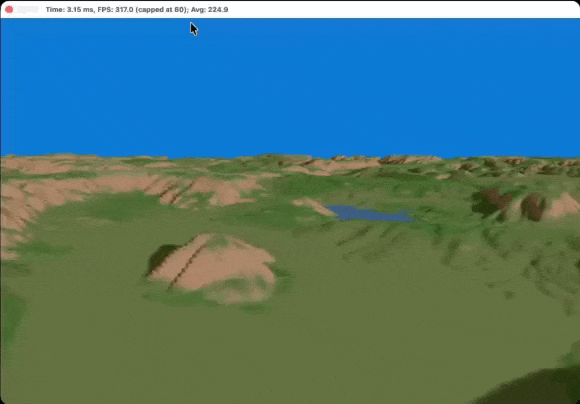

## voxelspace-rs

A Rust implementation of the [VoxelSpace](https://github.com/s-macke/VoxelSpace/tree/master) algorithm. It uses [minifb](https://crates.io/crates/minifb) to open a window that can take keyboard input and display the contents of the framebuffer; [image](https://crates.io/crates/image) to load the terrain map files, and [image-pyramid](https://crates.io/crates/image-pyramid) to create mipmaps of those.

Currently, this is an extremely basic demo. I intend to maybe make a game incorporating this kind of graphics algorithm eventually; I love the aesthetic.

Right now, this demo loads one hardcoded pair of terrain map files (heightmap and colormap) I took from the repo linked above, and it renders that terrain with some hardcoded parameters you can find in `src/config.rs`, with a controllable moving camera (whose motion parameters you can find in `src/camera.rs`).

I've only tested this on MacOS, but it doesn't use anything platform-specific.

### Requirements
[Rust](https://rust-lang.org/learn/get-started/) is currently the only requirement.

### How to run
`cargo run --release`
(Running in debug mode results in extreme slowdown)

### Controls
(currently hardcoded)
WASD - accelerate / decelerate and yaw
R - increase altitude
F - decrease altitude

#### TODO:

* Implement more layers of LOD. (*Wow*, does this algorithm create ugly results without mapmapping!)

* Desynchronize the logic from the frame rate? I'm undecided on that. There's some joy to be found in old video games when the whole thing would slow down as the boss spammed fancy projectiles or fancily exploded. On the other hand, different CPUs have different thresholds of running full-speed vs slowing down cinematically vs turning into a slideshow.

* Optimize multithreaded rendering

* Start turning this engine into a game? Would be fun to make the terrain destructible, give the player a ship with stuff to make craters in it.

#### BUGS:
* There's currently an obvious visual bug where the terrain appears degenerate at negative coordinates. This is because the camera coordinates are stored as floats, which are then cast to unsigned ints for calculating indices into the terrain maps, and those negative floats get flattened to zero.